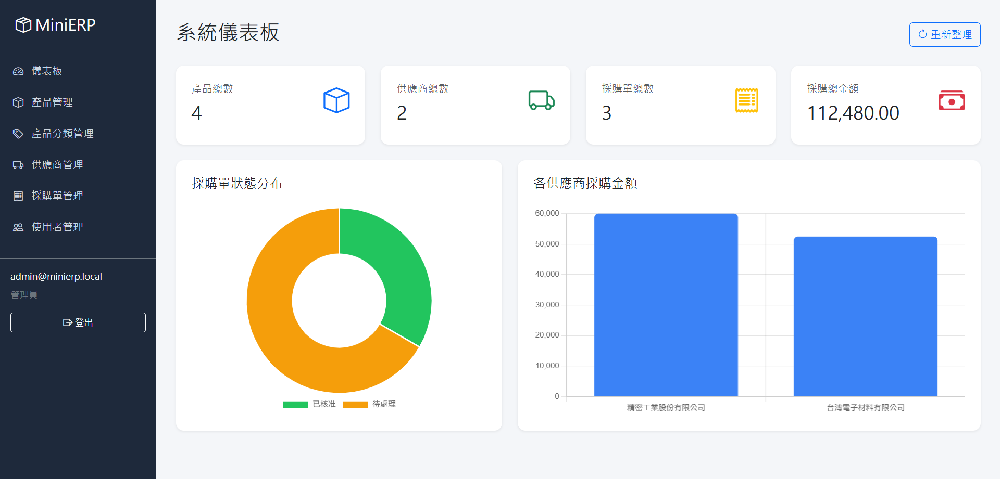
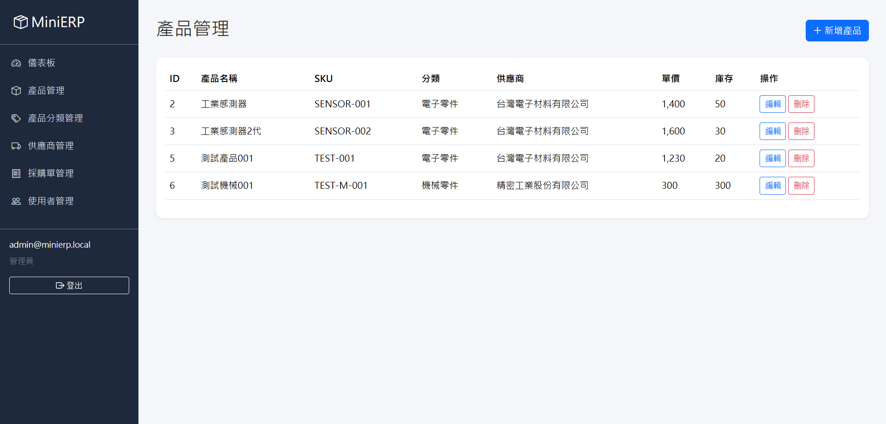
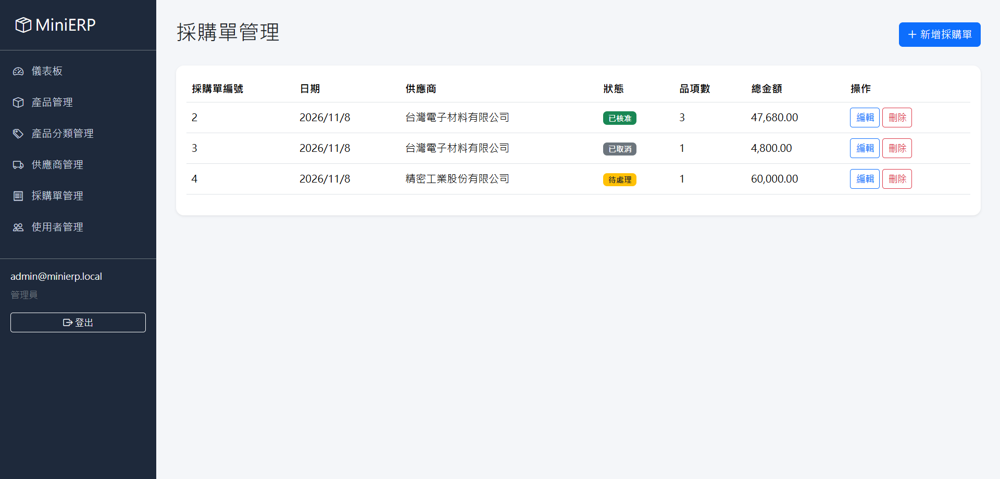

# MiniERP — 企業資源管理系統專案

MiniERP 是使用 ASP.NET Core 10 與 Entity Framework Core 10 開發的 ERP 專案，支援 Microsoft SQL Server 與 PostgreSQL，並透過 Docker 部署於 Render。

本專案以中小型企業的產品、供應商及採購管理為情境，實作資料管理、採購單作業、使用者權限控管及統計儀表板，練習從資料庫設計、後端 API 到前端管理介面的完整開發流程。

## 線上展示

**[開啟 MiniERP 線上 Demo](https://minierp-demo.onrender.com/)**

網站部署於 Render，資料庫使用 Neon PostgreSQL。Render 免費服務在閒置後可能休眠，因此首次開啟可能需要等待一段時間。

線上展示需要登入；展示帳號可另行提供，管理員帳號密碼不公開於 Repository。

## 技術架構

| 類別 | 使用技術 |
|---|---|
| 開發語言 | C#、JavaScript、HTML、CSS |
| 後端框架 | ASP.NET Core 10 |
| 網頁架構 | ASP.NET Core MVC、RESTful API |
| ORM | Entity Framework Core 10 |
| 資料庫 | Microsoft SQL Server Express（本機）、PostgreSQL（雲端） |
| PostgreSQL Provider | Npgsql.EntityFrameworkCore.PostgreSQL |
| 容器化與部署 | Docker、Render |
| 雲端資料庫服務 | Neon |
| 身分驗證 | ASP.NET Core Identity、Cookie Authentication |
| 前端介面 | Razor Views、Bootstrap 5 |
| 統計圖表 | Chart.js |
| 開發工具 | Visual Studio 2026 |

## 系統畫面

### Dashboard

### 產品管理

### 採購單管理

## 主要功能

### 1. 產品管理

- 新增、查詢、修改及刪除產品
- 管理產品 SKU、單價及庫存數量
- 設定產品分類與供應商
- SKU 唯一性檢查
- 資料格式與數值範圍驗證

### 2. 產品分類管理

- 分類 CRUD
- 顯示各分類的產品數量
- 防止刪除仍被產品使用的分類

### 3. 供應商管理

- 供應商 CRUD
- 管理聯絡人、電子郵件及電話
- 建立供應商與產品、採購單的關聯

### 4. 採購單管理

- 新增、查詢、修改及刪除採購單
- 一張採購單可包含多筆採購明細
- 管理產品、數量及採購單價
- 自動計算明細小計與採購單總金額
- 支援 Pending、Approved、Cancelled 狀態
- 使用資料庫交易維持資料一致性

### 5. Dashboard 統計儀表板

- 產品總數
- 供應商總數
- 採購單總數
- 採購總金額
- 採購單狀態分布圖
- 各供應商採購金額統計圖

### 6. 使用者與權限管理

- 使用者登入與登出
- Admin、Staff 角色權限
- 管理員建立使用者
- 修改使用者角色
- 停用及啟用使用者帳號
- 限制敏感操作權限
- 使用 Security Stamp 驗證登入狀態
- 使用 Anti-forgery Token 防止 CSRF 攻擊

## 系統架構

本專案採用 ASP.NET Core MVC 搭配 RESTful API。

主要資料流程：

使用者瀏覽器 → Razor Views / JavaScript → ASP.NET Core MVC / API Controllers → Entity Framework Core → SQL Server（本機）或 PostgreSQL（雲端）

後端使用 DTO 進行輸入資料驗證，並透過 Identity 管理身分驗證與角色授權。

本機開發使用 SQL Server Express；線上展示則由 Render 執行 Docker 容器，連線至 Neon PostgreSQL。資料庫 Provider 與連線字串由應用程式設定及環境變數決定，並分別維護 EF Core Migration。正式環境的連線資訊與管理員初始化密碼透過環境變數設定，不提交至 GitHub。

### 系統架構圖

詳細說明請參考 [系統架構文件](docs/system-architecture.md)。

## 資料庫設計

主要業務資料表：

- Categories：產品分類
- Suppliers：供應商
- Products：產品
- PurchaseOrders：採購單主檔
- PurchaseOrderItems：採購單明細

另外使用 ASP.NET Core Identity 提供的資料表管理使用者、角色及相關驗證資訊。

主要關聯：

- 一個分類可包含多個產品
- 一個供應商可對應多個產品
- 一個供應商可對應多張採購單
- 一張採購單可包含多筆明細
- 每筆採購明細對應一個產品

### 資料庫 ERD

詳細說明請參考 [資料庫 ERD](docs/database-erd.md)。

## 安全性與資料完整性

- ASP.NET Core Identity Cookie Authentication
- Admin / Staff 角色授權
- Anti-forgery Token
- DTO 資料驗證
- 關聯式資料庫外鍵與唯一索引（SQL Server / PostgreSQL）
- EF Core Transaction
- 全域 API 例外處理
- 避免向使用者顯示資料庫內部錯誤細節

## 專案定位

MiniERP 是用於學習與展示的作品集專案，並非正式商用 ERP 系統。

目前已完成基本資料管理、採購作業、身分驗證、權限控管、資料庫操作，以及使用 Docker、Render 與 Neon PostgreSQL 的線上展示部署。尚未實作完整的庫存異動流程、採購核准工作流及 ERP 外部系統整合；線上展示部署不等同於具備完整商用維運能力。

## 後續可擴充方向

- 採購單核准與入庫流程
- 庫存異動紀錄
- 低庫存警示
- 採購及庫存報表
- API 分頁、排序與搜尋
- 自動化測試
- ERP 系統資料交換與整合
